# Eclipse Pyramids

Eclipse Pyramids is a WebGL "cube world". It contains a platform of sand dunes with the three pyramids of Giza, and a sun and moon made of cubes crossing the sky and resulting in an eclipse. Every object on screen, including the ground, the pyramids, the sun, the moon, and the sky, is the same 2 × 2 × 2 cube drawn with a different model matrix. [You can view the site here.](https://project2-gamma-two.vercel.app/).

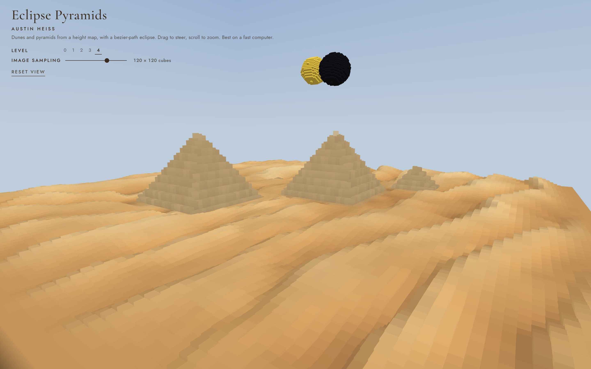

## Design plans

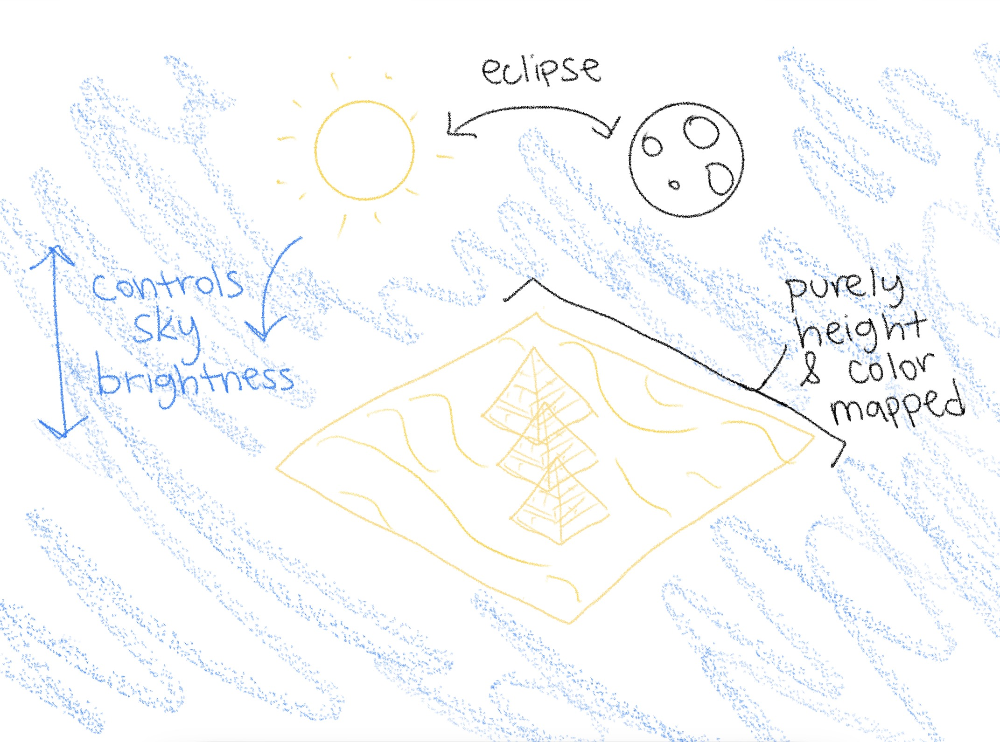

*My design sketch. The moon passes over the sun (the eclipse), the sun controls how bright the sky is, and the dune platform with the pyramids is purely height and color mapped from images.*

The idea was a desert that floats in the sky, with a dunes and the Giza pyramids, and a solar eclipse happening overhead. This was inspired by the (myth?) that the pyramids were build in alignment with a solar eclipse.  I also wanted the eclipse to *do* something to the scene, so the whole landscape and sky dim/brighten when the moon slides over the sun. Pyramids also seemed like a good fit for the project due to their cube building blocks.

| Level | What it adds |
| --- | --- |
| **0** | A single cube at the origin. |
| **1** | A procedural grid of cube columns, with heights from sine waves plus a little randomness. |
| **2** | Column heights and colors sampled from two images (a grayscale height map and a color map). |
| **3** | A sun and moon built from small cubes, moving along cubic bezier curves and spinning. |
| **4** | A gradient sky and eclipse dimming when the moon covers the sun. |

The constraints from the assignment shaped most of the design. Because the only model is a cube, the pyramids are not separate meshes. They are baked into the same height map as the dunes. The sun and moon are balls of small cubes rather than spheres.

## What you can do

The scene is already moving when the page opens. The camera slowly circles the platform (one full lap every 2 minutes), and in level 3 and 4 the sun and moon cross the sky once a minute.

| Control | Action |
| --- | --- |
| **Drag left / right** | Walk the camera around the platform. The automatic camera movement pauses while you hold the mouse down. |
| **Drag up / down** | Raise or lower the camera. It never goes below a height of 1. |
| **Scroll** | Zoom in and out. |
| **Level 0–4** | Switch between the levels in the table above. |
| **Image sampling slider** | Choose how many cubes per side are used to sample the images (default 120 × 120). At Level 1 it is labeled **Grid size** and sets the procedural grid instead. It is hidden at Level 0. |
| **Reset view** | Move the camera back to its starting position. |

The header shows the controls with color changing text so it stays readable.

### Tour of the interface

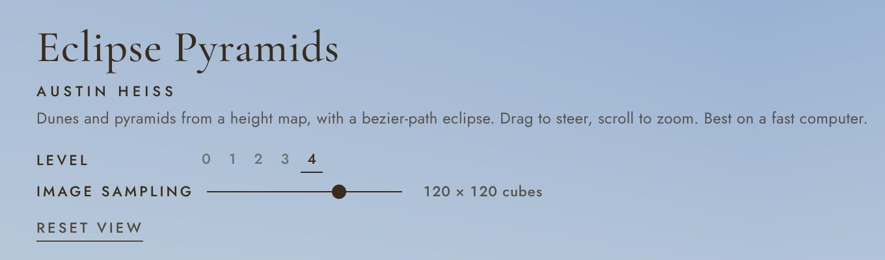

**Header.** The header contains the title, my name, a description, the level buttons, the image sampling slider, and reset view button. 

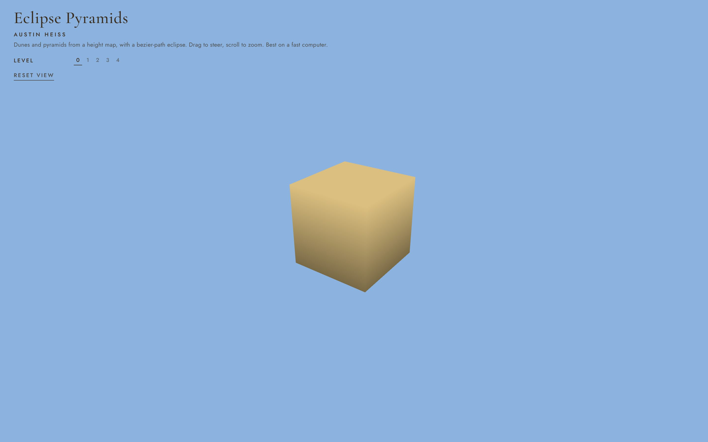

**Level 0: one cube.** The starting point is a single cube at the origin. The camera moves in close and orbits so you can see how the top of the cube is brighter than the bottom.

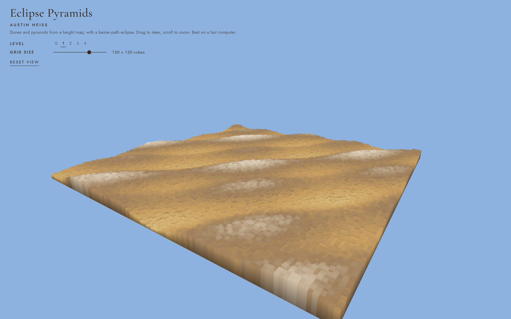

**Level 1** Level one is the procedural grid. Each column's height comes from a few sine waves plus random noise. The height also picks the color from a ramp (sand, darker sand, rock, pale peaks), so the tallest parts approach white.

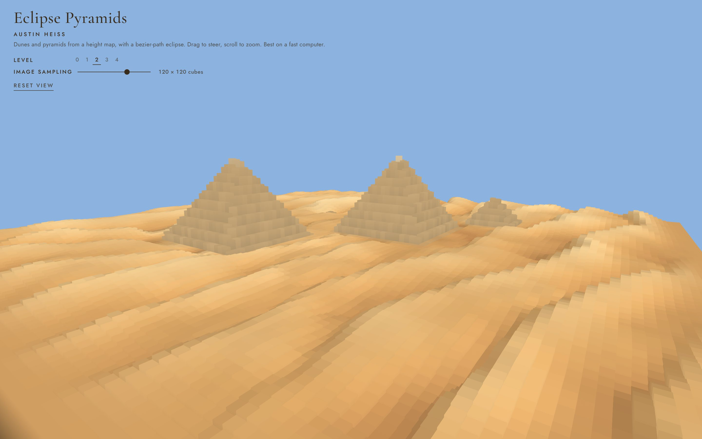

**Level 2** Here the heights and colors come from image maps instead of a formula. The dunes and pyramids are both in the images, so they are drawn the same way.

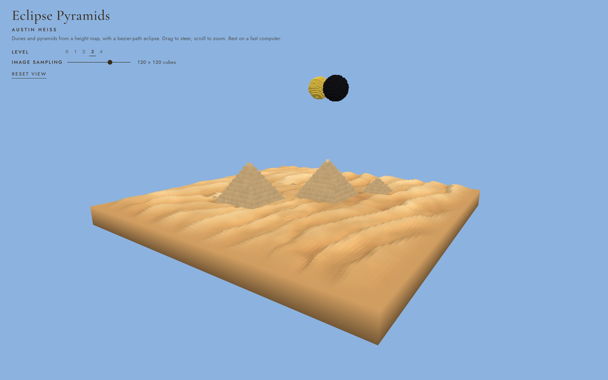

**Level 3** This level adds the sun and moon, which are each a ball of cubes. They rise in the east, cross the sky, and pop back to the start after they reach the west.

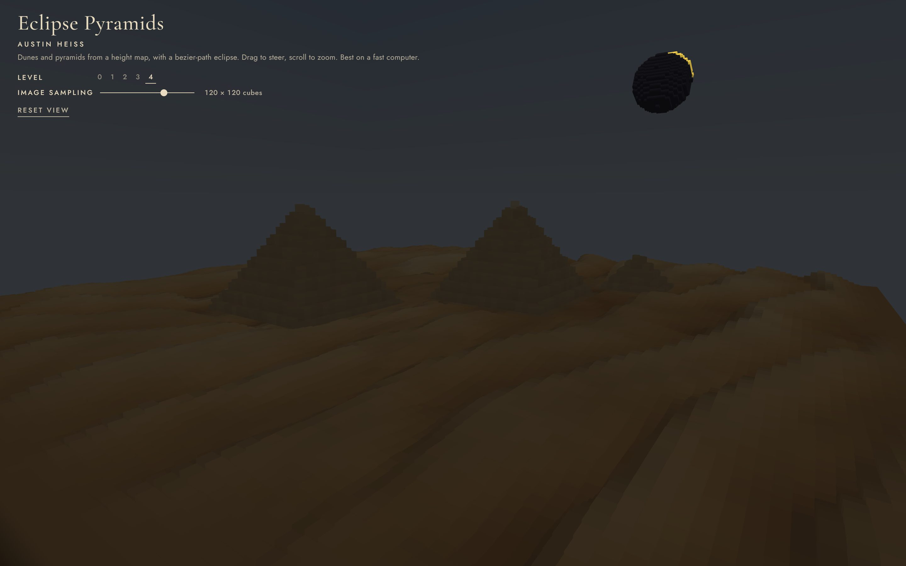

**Level 4** Level 4 is about the sky gradient and eclipse lighting the scene. At totality the sky, dunes, and pyramids drop to 15% brightness, and the header text switches to a pale color so it stays readable. Depending on where the camera is, the edge of the sun can still peek out around the moon. I used claude on this level to bring my original vision to life, as this level was optional to do anything extra.

#### Image sampling resolution

The slider changes how finely the images are sampled. Fewer cubes are faster but blockier. More cubes show more of the dune detail but are more compute intensive.

| 30 × 30 | 160 × 160 |
| --- | --- |
| 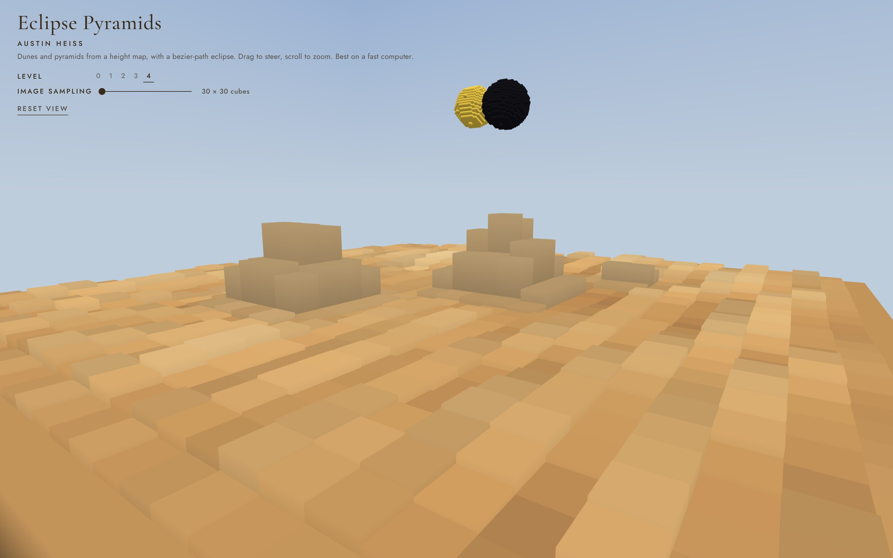 | 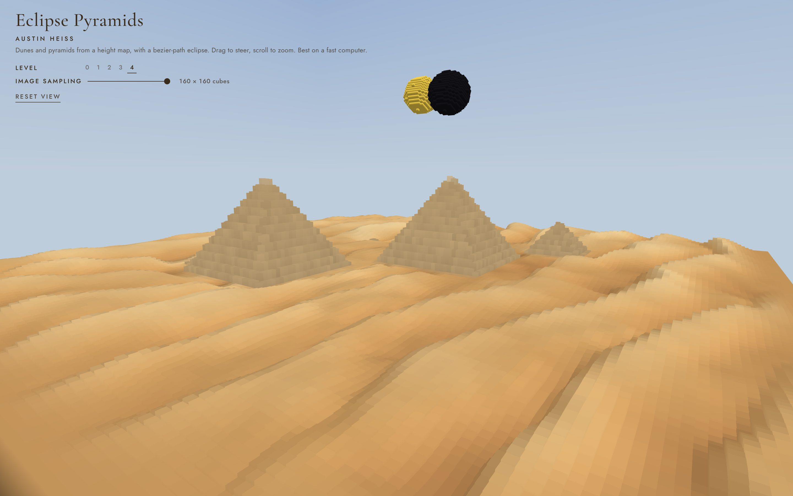 |

At 30 × 30 the pyramids just look like a couple steps. At 160 × 160 the dunes and pyramid steps are much finer.

## How it works

The code is plain JavaScript and WebGL.:

| File | Steps | Purpose |
| --- | --- | --- |
| [`js/renderer.js`](js/renderer.js) | 1–3 | Gets the WebGL context and compiles the vertex and fragment shaders. |
| [`js/cube.js`](js/cube.js) | 4 | The cube's 36 vertices. |
| [`js/mat4.js`](js/mat4.js) | 5 | Vector and matrix helpers. |
| [`js/landscape.js`](js/landscape.js) | 6 | Builds the land cubes for the procedural grid. |
| [`js/sky.js`](js/sky.js) | | The sun, moon, bezier paths, and eclipse brightness. |
| [`js/main.js`](js/main.js) | 7–9 | Camera, drawing, mouse and header controls, and the animation loop. |
| [`tools/*.py`](tools/) | | Python scripts that generate the terrain images. |

### 1. One cube made of vertices and triangles

In Project 1 the models were lists of vertices, edges, and triangular faces. Here there is only one model. [`cube.js`](js/cube.js) lists the 36 vertices of a 2 × 2 × 2 cube. It has 6 faces, 2 triangles per face, and 3 corners per triangle, with each corner between −1 and 1. The corners are listed counter-clockwise when seen from outside, so WebGL can skip the back faces (`gl.CULL_FACE`). The positions are uploaded to the GPU once and reused for every cube that is drawn.

### 2. Placing cubes with model matrices (translate, scale, rotate)

Each cube in the scene is just `{ position, scale, color }`. `makeModelMatrix()` in [`mat4.js`](js/mat4.js) builds a 4 × 4 matrix that scales the cube and then translates it. The translation sits in the last column of the matrix. A dune column is a cube scaled to the width of its grid cell and stretched up to its height, then moved so its base sits at the bottom of the floating platform (`y = −12`).

The sun and moon add rotation. `rotationX()` and `rotationY()` build rotation matrices, and `multiply()` combines them. Each small cube in a ball is drawn with:

```text
model = Translate(ball center) × RotateY(spin) × RotateX(25°) × Translate(offset) × Scale(1)
```

That keeps the cube at its 2-unit size (the scale is there so the same `makeModelMatrix()` works for every cube), moves it out to its spot on the ball's surface, tilts the ball, spins the whole ball, and moves it to its point on the bezier curve. The tilted spin axis makes the shading on the cubes roll around as they turn.

### 3. The pinhole camera

Project 1 projected points with the pinhole relationship `u = x / z`, `v = y / z` so it was nice that WebGL basically does the same thing but with two matrices:

- **View matrix.** `lookAt(eye, target, up)` builds the camera's right, up, and backward axes from the eye and target, then moves the whole world so the camera sits at the origin looking down −Z.
- **Projection matrix.** `perspective(fov, aspect, near, far)` uses a 60° field of view. Its `f = 1 / tan(fov / 2)` plays the role of the focal length. The matrix copies `−z` into the `w` coordinate, and the GPU then divides by `w`. That divide is the same divide-by-depth as in the pinhole camera, so distant cubes come out smaller.

Each vertex goes `projection × view × model × position` in the vertex shader. The camera orbits a target point near the center of the platform: its eye is at `(r·sin(angle), height, r·cos(angle))`, and every frame `animate()` moves the angle by `2π / 120` per second. Dragging changes the angle and height, and scrolling changes the radius `r`.

### 4. Triangles, depth, and vertex color interpolation

Instead of filling triangles and keeping a depth buffer by hand like in Project 1, WebGL rasterizes the triangles and does the depth test for us (`gl.DEPTH_TEST`). There is no lighting. The vertex shader gives every corner a color, and the fragment shader just outputs the blended color.

Bottom corners get 55% of the cube's color and top corners get 100%. Since `v_color` is a varying, the GPU interpolates it across each triangle. That makes each column's sides fade from dark at the bottom to light at the top, which is what makes the dune ridges and pyramid steps more noticeable.

### 5. Level 1

`buildProceduralGrid(n)` loops over an `n × n` grid. For each cell it adds two sine-wave patterns and a small random value to get a number `t` between 0 and 1, makes the column `0.5 + 10t` units tall, and picks its color from `colorRamp(t)`, which blends between four color stops with `lerp()`.

### 6. Level 2

The terrain comes from two 1024 × 1024 images in [`assets/`](assets/):

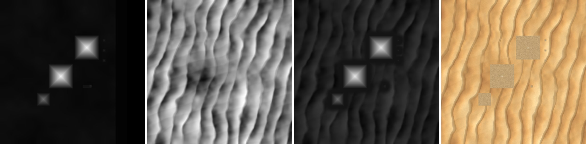

*Left to right: `giza_height.png`, `dunes_height.png`, `terrain_height.png` (what the app loads for heights), and `terrain_color.png` (what the app loads for colors).*

To read the pixels, `readPixels()` draws each image onto a canvas and calls `getImageData()`, which returns the RGBA numbers. Then, for each of the `n × n` grid cells, `sampleCell()` averages all the pixels that fall inside that cell. At 120 × 120, each cube covers about 8.5 × 8.5 pixels, and averaging them avoids the jagged look you get from reading one pixel per cell.

The color map gives the column's color directly. Near the outer edge of the platform, both height and color ease down to a flat rim, so the floating platform has a clean edge.

The images themselves are made by three Python scripts made entirely by Claude in [`tools/`](tools/):

- `make_dune_height.py` generates the dune height map. Each dune is a lopsided sawtooth with a long windward slope and a steep slip face, with wandering crests, a weaker crossing set of dunes, and bumps in the troughs.
- `make_dune_color.py` colors the dunes from their heights: dark red-brown sand in the troughs, golden sand in the middle, pale sand on the crests, and slightly lighter windward slopes.
- `make_terrain.py` combines the dunes with `giza_height.png`. It flattens the dunes into a plateau around the pyramids, sets the pyramids on top, colors them limestone (paler near the tips), and writes the heights back out as gray using the same formula that `landscape.js` reads them with.

### 7. Level 3

The sun follows a cubic bezier curve with four control points that make an arc from the east to the west. The ends of the arc stay above the horizon, so the balls never sink into the dunes. They pop in at the east end and pop out at the west end. The moon uses the same curve scaled to 95%, so it is slightly closer to the camera and passes in front of the sun.

`cubicBezier()` in [`sky.js`](js/sky.js) uses De Casteljau's algorithm. It linearly interpolates between neighboring control points, which turns 4 points into 3, then 3 into 2, then 2 into 1. That last point is the point on the curve:

```js
const q0 = lerp(p0, p1, t), q1 = lerp(p1, p2, t), q2 = lerp(p2, p3, t);
const r0 = lerp(q0, q1, t), r1 = lerp(q1, q2, t);
return lerp(r0, r1, t);
```

The day runs from `t = 0` at sunrise to `t = 1` at sunset over 60 seconds. The moon's position is `0.5 + 0.8 × (t − 0.5)`, so it moves at 80% of the sun's speed but lines up with the sun at exactly `t = 0.5`. That is the eclipse.

Each ball is built by `buildBall()`. It walks a 3D grid of 2-unit cubes and keeps only the ones close to the sphere's surface, since the inside would never be seen. The moon is slightly bigger so it can fully cover the sun. The sun spins once every 40 seconds and the moon once every 55 seconds in the other direction.

### 8. Level 4

**Eclipse dimming.** `skyBrightness(eye)` measures, from the camera's position, the angle between the directions to the sun and the moon, and how big each ball looks (radius divided by distance). From those it works out how much of the sun is covered, from 0 when the discs just touch to 1 when the sun is completely behind the moon. The brightness is `1 − 0.85 × covered²`, so it stays bright until near totality and bottoms out at 15%. That number multiplies the background color, the sky, and every land cube's color before it is sent to the shader.

**Sky gradient.** The sky is one more cube, 2,000 units wide, centered on the camera horizontally with its bottom face at eye height. Since the camera is inside it, `drawSkyBox()` culls the front faces instead of the back ones, so only the inside is drawn. It is also drawn first with depth writes turned off, so everything else paints over it. In the vertex shader, its corners blend from the horizon color at the bottom to deep blue at the top, and the same vertex color interpolation from section 4 turns that into a good gradient.

### 9. The animation loop

`animate()` runs every frame with `requestAnimationFrame`. It moves the camera around its orbit (unless you are dragging), advances the sun and moon at Levels 3 and 4, and calls `draw()`. `draw()` clears the screen, draws the sky cube at Level 4, draws every land cube, and draws the sun and moon at Levels 3 and 4. Each cube is its own `gl.drawArrays()` call. The header controls only change settings (the level, the grid size, or the camera), and the next frame picks them up.

## Running it locally

The images cannot be read from a `file://` page, so the project needs a local server:

```bash
python3 tools/serve.py
```

Then open <http://localhost:8000>. `serve.py` turns off caching so the browser never runs a stale copy of the JavaScript. To regenerate the terrain images, run `make_dune_height.py`, then `make_dune_color.py`, then `make_terrain.py` (these need `pillow` and `numpy`).

## Future work and attempts

- **Draw faster with batching or instancing.** Every cube is a separate draw call with its own uniforms, which is the main performance limit. Putting all of the land cubes into one big vertex buffer (or using instanced drawing, which WebGL 1 has as the `ANGLE_instanced_arrays` extension) would turn about 16,500 draw calls into a handful. That would make larger grids smooth on slower computers.
- **Add real lighting.** The shading now is just "darker at the bottom of each cube." Adding face normals and a directional light that comes from the sun's position would let the dunes' slip faces fall into shadow and make the light actually move across the desert during the day.
- **A more convincing eclipse.** At totality, a real eclipse shows the sun's corona and stars come out. Neither is in the scene yet.

### Attempts that were tried and reverted

**A bigger dune field.** I tried making the dune field 4 times larger (200 × 200 world units instead of 100 × 100) and sampling it at 160 × 160 cubes. The larger field looked better, but 160 × 160 meant 2.5 times as many draw calls as before, and since every cube is its own draw call that was too slow. I kept the larger field but lowered the grid to 120 × 120 cubes for performance. The slider can still go up to 160 if your computer can handle it.

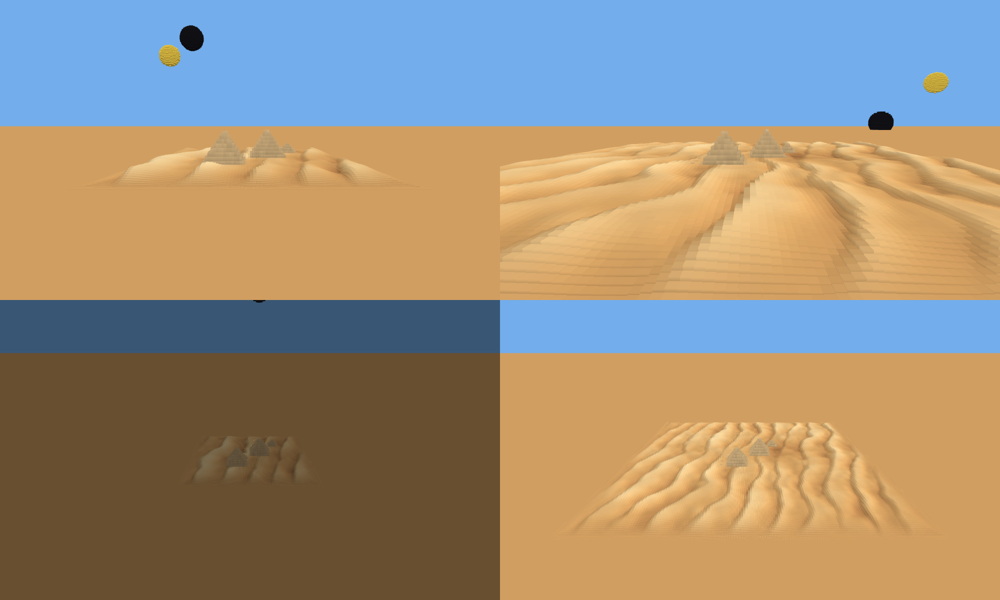

**A moon that sets behind the dunes.** One version brought the moon down after the eclipse so that it set behind the dunes (bottom row) instead of continuing across the sky (top row). In the end I kept the version where both balls stay in the sky and pop in and out at the ends of their curves.

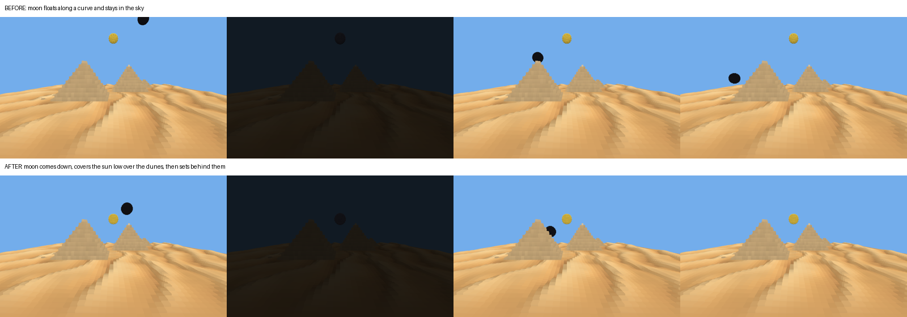

**A darker-at-the-bottom sky gradient.** I tried a gradient that got darker toward the horizon instead of paler. The first try came out too dark and the next one too flat, so I went back to a pale horizon fading up to deep blue.

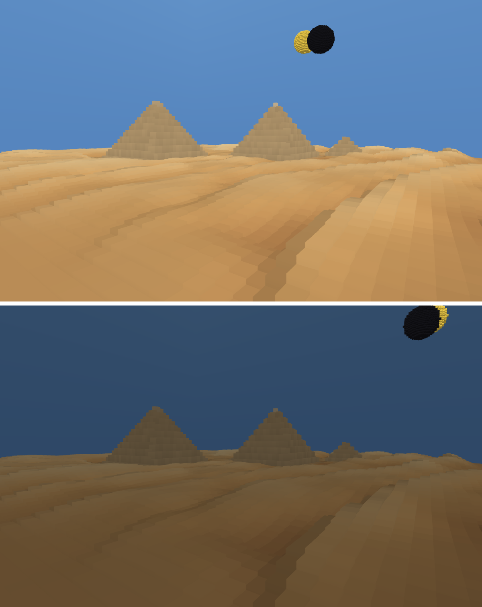

## Demo video

[Watch the demo on YouTube](https://youtu.be/Enjf-nwQQ4A)

The video walks through each level, the controls, and the eclipse.

## AI disclosure

Generative AI assisted with parts of the JavaScript implementation, the Python scripts that generate the dune and terrain images, and with drafting and editing the markdown formatting of this README and the screenshots in it. AI was also used to poke holes in my implementations as I worked.
